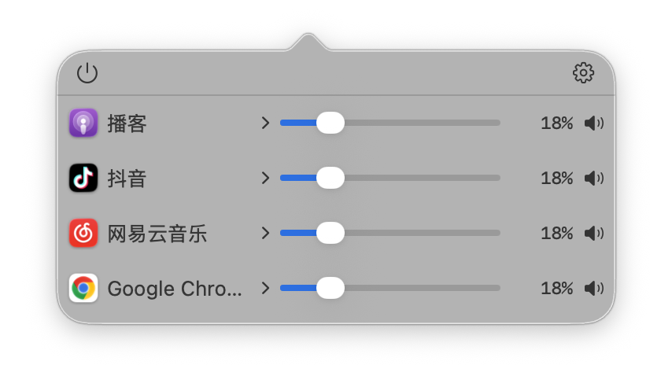
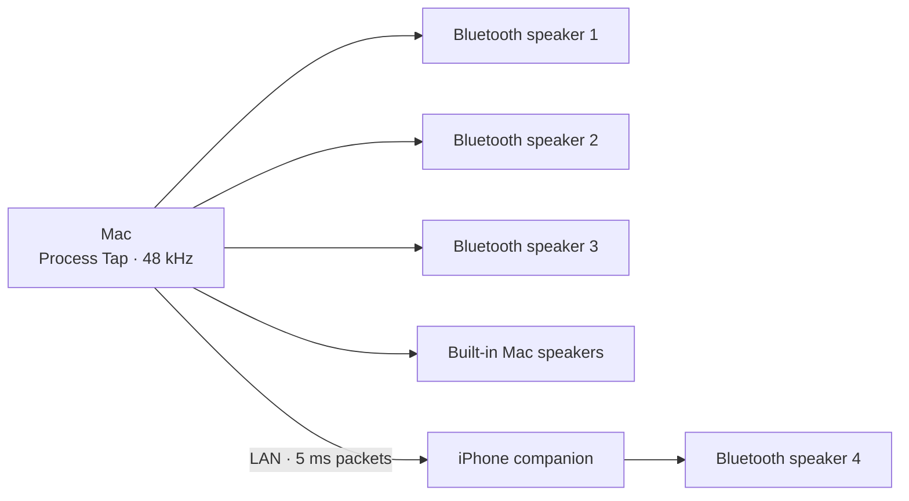
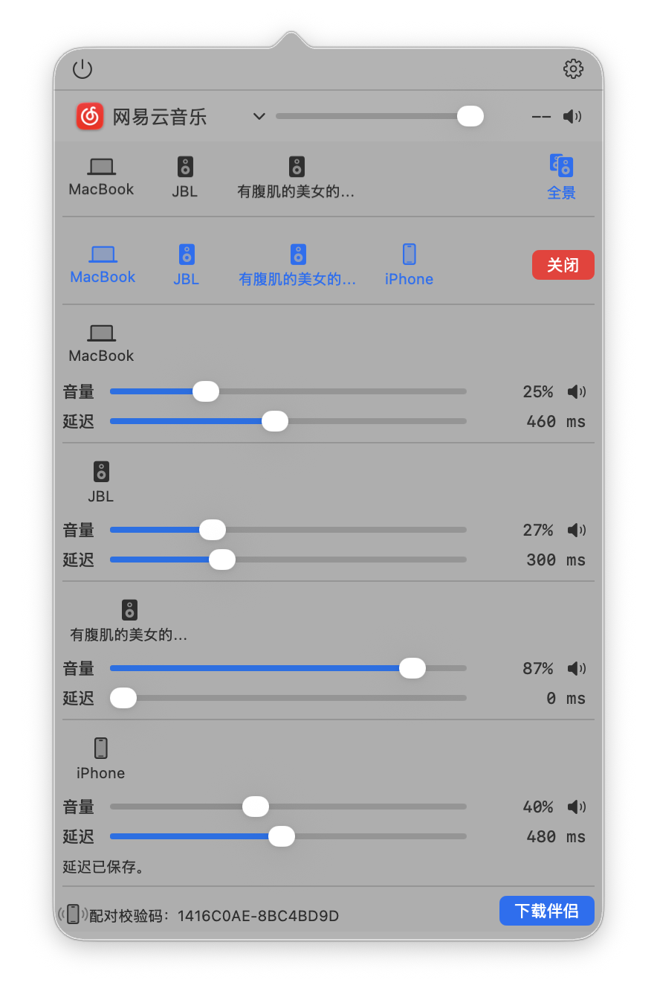
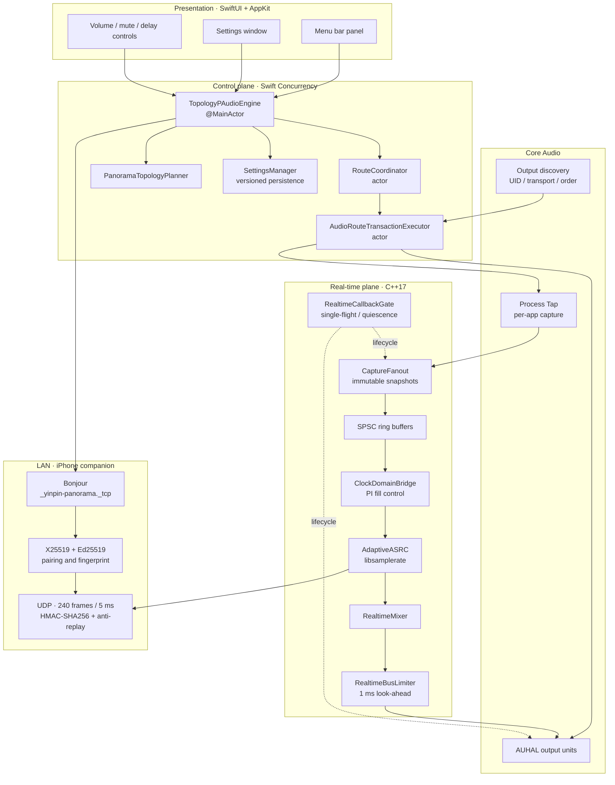
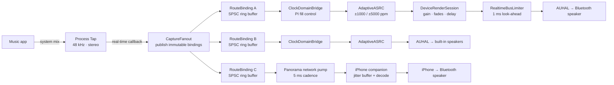
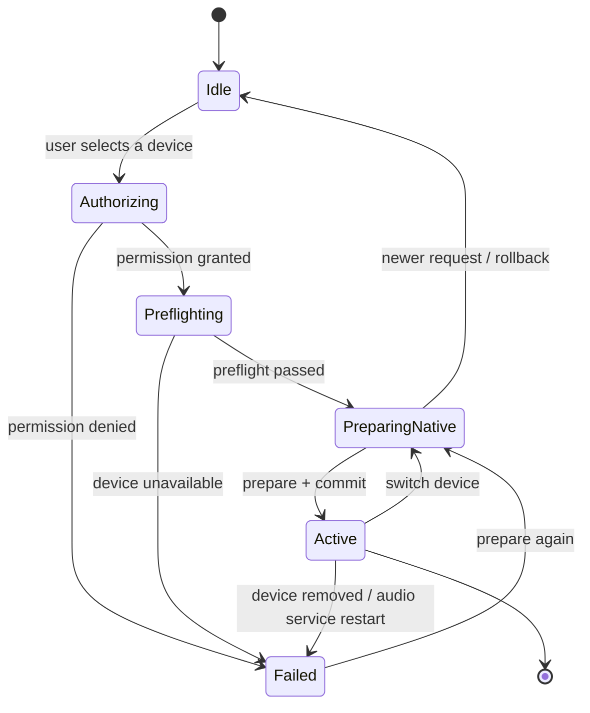
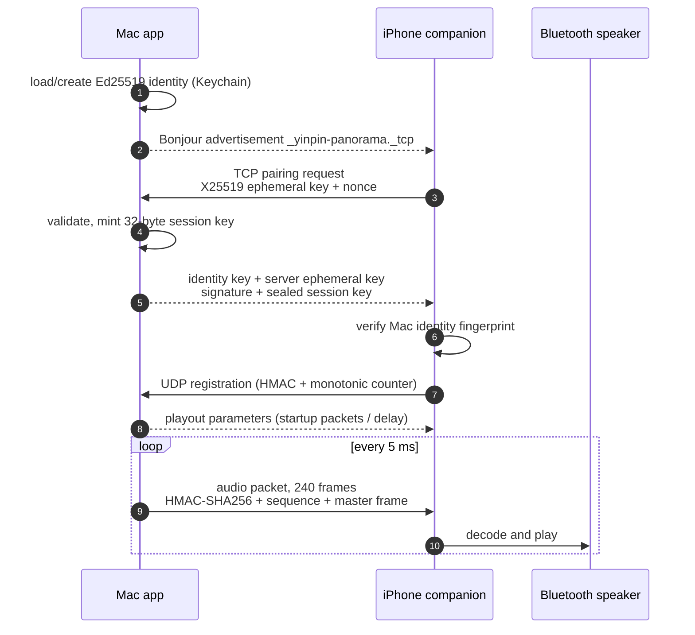

<p align="center">
  
</p>

<h1 align="center">Audio Switch</h1>

<p align="center">
  Turn the old Bluetooth speakers gathering dust at home into a controllable multi-room audio system for your Mac.
</p>

<p align="center">
  <a href="README.md">简体中文</a> | English
</p>

<p align="center">
  
  
  
  
  <a href="LICENSE"></a>
  <a href="https://github.com/feijinloeng/audio-switch/actions/workflows/ci.yml"></a>
</p>

---

## At a glance

Audio Switch is a real-time audio routing system for macOS. It captures audio per app with the **Core Audio Process Tap**, runs it through a hand-written **C++17 real-time core** (lock-free ring buffers, a PI clock-domain controller, adaptive resampling, bus limiting), and fans it out to up to **five endpoints** at once: three Bluetooth speakers connected to the Mac, the built-in Mac speakers, and one iPhone bridged over the local network.

It solves a very specific hardware problem: old Bluetooth speakers only speak A2DP. No AirPlay, no Wi-Fi — but they still sound fine.

| Engineering | Implementation |
| --- | --- |
| **Languages** | Swift 5.9+ / SwiftUI + C++17 real-time core |
| **Size** | 75 Swift files, 19 C++ files, roughly 18k lines of first-party code |
| **Real-time contract** | No allocation, locks, logging, or blocking inside audio callbacks |
| **Clock sync** | Per-device PI controller + adaptive libsamplerate conversion |
| **Routing model** | prepare → commit → rollback transaction; a failed switch never stops current playback |
| **Security** | X25519 pairing, Ed25519 identity fingerprint, HMAC-SHA256 audio packets, anti-replay counter |
| **Quality** | 22 unit tests + GitHub Actions Debug/Release builds with strict concurrency |

## Contents

- [What this is](#what-this-is)
- [Capabilities](#capabilities)
- [Screenshots](#screenshots)
- [Architecture](#architecture)
- [Hard problems and trade-offs](#hard-problems-and-trade-offs)
- [Quality](#quality)
- [Privacy and security](#privacy-and-security)
- [Install](#install)
- [Build from source](#build-from-source)
- [Project layout](#project-layout)
- [Known limits](#known-limits)
- [Roadmap](#roadmap)
- [Contributing](#contributing)
- [License and third-party code](#license-and-third-party-code)

## What this is

### Why it exists

Audio Switch targets one specific class of hardware:

1. It can only decode legacy **A2DP** (Bluetooth stereo audio).
2. It has no AirPlay and no Wi-Fi audio capability.
3. It still sounds fine — it just lacks a modern way to connect.

This project is not an AirPlay implementation and does not build a Wi-Fi mesh the way AirPlay does. It gives these old devices a direct path to keep being used.

### What you can do with it

1. **Per-app routing**: route each music app's audio to a different output device while everything runs at once.
2. **Different audio on different speakers**: for example, music app A plays to speaker 1 and music app B plays to speaker 2.
3. **Panorama playback**: group several output devices into one playback group so they play the same audio together, for a wider, more spatial sound.
4. **Extended output**: up to 3 Bluetooth speakers connected directly to the Mac, plus the built-in Mac speakers and one iPhone bridge output.

## Capabilities

| Capability | Description |
| --- | --- |
| Per-app routing | Pick a different output device for each music app, with independent volume and mute. |
| Panorama playback | Up to 3 Bluetooth speakers, the built-in Mac speakers, and one iPhone output — 5 output points playing the same audio. |
| Clock correction | Each output tracks its own buffer fill independently, reducing drift and dropouts during long playback. |
| Manual delay alignment | Per-output delay from 0 to 1000 ms compensates for different Bluetooth decode latencies. |
| iPhone companion | Makes an iPhone an additional playback endpoint on the same LAN, bridging a 4th Bluetooth speaker. |
| Hot-plug | Add or remove speakers, or connect/disconnect the iPhone, during playback without silencing the other devices. |
| Anti-pop | Fade in/out, gain ramps, and bus limiting reduce sudden pops when switching. |
| System-default passthrough | When an app follows the system default at 100% volume, the audio chain is left untouched — no added latency, no wasted resources. |

### Output capacity

| Output location | Count | Connection |
| --- | ---: | --- |
| Bluetooth speakers connected to the Mac | Up to 3 | Mac Bluetooth + A2DP |
| Built-in Mac speakers | 1 | Mac built-in audio output |
| Bluetooth speaker bridged by iPhone | 1 | Mac → LAN → iPhone → Bluetooth speaker |
| **Output points sounding at once** | **Up to 5** | 3 Bluetooth speakers + Mac speakers + 1 iPhone-bridged speaker |



## Screenshots

### Per-app routing

Each app gets its own output device, volume, and mute state.

<p align="center">
  
</p>

### Panorama playback

In panorama mode you can set volume and delay per output, and add or remove devices during playback.

<p align="center">
  
</p>

## Architecture

See [docs/ARCHITECTURE.en.md](docs/ARCHITECTURE.en.md) for the full design write-up.

### System layers



### Audio data path



Three properties matter:

1. **One capture, many outputs.** `CaptureFanout` distributes a single Process Tap callback to N `RouteBinding`s, each with its own SPSC ring buffer, so no output can block another.
2. **Every output keeps its own clock.** Bluetooth, built-in audio, and the network companion consume at different rates. `ClockDomainBridge` turns buffer-fill error into a resampling ratio, and `AdaptiveASRC` applies it inside the callback.
3. **The network only transports.** The iPhone receives 48 kHz / 16-bit / stereo PCM, 240 frames per packet, with its own jitter buffer and playout watermark.

### Buffering and start-up

| Output type | Pre-roll / start-up | Purpose |
| --- | ---: | --- |
| Wired / built-in | 40 ms | Low latency |
| Bluetooth | 171 ms | Absorbs the brief transport stall after a route change |
| Panorama local output | 1 s | Shared 48 kHz timeline plus room for manual delay |
| iPhone companion | 200 packets = 1 s | Network jitter buffer, capped at 260 packets (1.3 s) |

### Route transaction state machine

Switching an output is a transaction with rollback, not a variable assignment. The old route stays usable until the new one has actually committed.



Key invariants in `AudioRouteTransactionExecutor`:

- Concurrent requests for one app converge on a `requestID`; stale transactions roll back at a safe boundary.
- The previous route is released only after the new one commits. On failure, the old route survives.
- A HAL service restart advances `halEpoch`; async completions from an older epoch are rejected.

### iPhone companion protocol



Protocol details:

| Item | Design |
| --- | --- |
| Discovery | Bonjour `_yinpin-panorama._tcp`; TXT record carries port and protocol version |
| Pairing | Ephemeral X25519 key agreement; Mac signs with its Ed25519 long-term identity; session key sealed end-to-end |
| Identity check | The Mac public-key fingerprint can be compared in the UI, blocking LAN man-in-the-middle |
| Audio packet | 240 frames × 2 channels × 16-bit = 960 B PCM; header carries `sessionID`, `sequence`, `masterFrame` |
| Integrity | HMAC-SHA256 truncated to 16 B; a failed tag is dropped before the jitter buffer |
| Anti-replay | Registration carries a monotonic counter inside the HMAC; the host accepts only strictly greater values |
| Takeover guard | While the active companion keeps heartbeating, new pairing requests are refused (10 s grace period) |
| Recovery | Interruption, route change, engine reconfiguration, and UDP failure map to distinct recovery actions |

### Real-time core modules

| Module | Responsibility | Real-time contract |
| --- | --- | --- |
| `RealtimeRingBuffer` | Stereo Float32 SPSC ring buffer | Allocation only at creation; lock-free, log-free read/write |
| `CaptureFanout` | Holds immutable binding snapshots, fans out one callback | Publish/acknowledge serialized by the control plane |
| `ClockDomainBridge` | PI controller turning fill error into ppm correction | ±1000 ppm steady, ±5000 ppm recovery, 5000 ppm/s slew |
| `AdaptiveASRC` | Ratio-driven sample-rate conversion | Preallocated state and scratch; no allocation |
| `DeviceRenderSession` | Per-device mixing, gain, fades, delay | Reads immutable snapshots only |
| `RealtimeMixer` | Mixes multiple bindings | Explicit silence when source count is 0 |
| `RealtimeBusLimiter` | Output bus peak limiting | Fixed 1 ms look-ahead with a smooth gain ramp |
| `RealtimeCallbackGate` | Single-flight admission and quiescence proof | Once closed, no callback can touch shared state |

### Tech stack

| Layer | Technology |
| --- | --- |
| UI | SwiftUI, AppKit (`NSStatusItem` menu bar), Observation |
| Concurrency | Swift Concurrency (actor / @MainActor / Task), complete concurrency checking |
| Audio | Core Audio HAL, Process Tap, AUHAL, AudioHardware aggregate devices |
| Real-time DSP | C++17, libsamplerate 0.2.2 (sinc converter) |
| Networking | Network.framework (Bonjour, TCP, UDP), CryptoKit (X25519 / Ed25519 / HMAC-SHA256) |
| Persistence | Versioned JSON settings, Keychain for the long-term pairing identity |
| Tooling | Swift Package Manager + Xcode project, GitHub Actions, shell release script |

### Code size

```text
Swift     75 files   ~15,000 lines   Mac app / iPhone companion / tests
C++       19 files    ~3,000 lines   real-time audio core (excluding libsamplerate)
Tests     22 cases                   real-time core / route transactions / protocol / persistence
```

## Hard problems and trade-offs

### 1. Bluetooth clock drift

Every Bluetooth speaker has a slightly different crystal, so buffers slowly drain or overflow during long playback. The approach:

1. Keep an independent fill target per output.
2. A PI controller converts fill error into a sample-rate correction (±1000 ppm steady state).
3. An adaptive resampler applies the correction instead of dropping or duplicating frames.
4. Recovery mode allows ±5000 ppm with a 5000 ppm/s slew, avoiding audible pitch jumps.

### 2. Hot-plug without interrupting other devices

Adding or removing one speaker rebuilds only the affected output snapshot. `OutputRenderSnapshotState` tracks which binding tokens the current render snapshot actually borrows; only those trigger a snapshot replacement. Untouched devices keep their ASRC state instead of resetting.

### 3. Pops when switching

Three layers of protection:

1. Mute is a continuous gain ramp, not a hard zero.
2. The device render session applies fade in/out.
3. The bus limiter uses 1 ms look-ahead to tame transients.

### 4. The Bluetooth bandwidth ceiling

This is not something software can lift. A Mac Bluetooth chip can carry only so many A2DP streams. In practice 2 speakers + a Bluetooth mouse is stable; 3 speakers may jitter. That is why a 4th speaker goes through the iPhone bridge instead of a direct Mac connection.

### 5. Memory lifetime on the real-time thread

Audio callbacks cannot allocate, lock, or log. All buffers and state are allocated during prepare; callbacks only read immutable snapshots. `RealtimeCallbackGate` proves quiescence — it waits for the admitted callback to leave before memory is released.

### 6. The security boundary of LAN audio

Pairing requests come from unauthenticated devices on the LAN, so:

- Session keys never touch disk.
- Audio packets are HMAC-verified before entering the jitter buffer.
- Registration packets carry a monotonic counter; captured packets cannot be replayed.
- While the active companion is still heartbeating, a new device cannot take over the endpoint.

## Quality

| Practice | Detail |
| --- | --- |
| Unit tests | 22 cases covering ring buffers, callback gates, gain ramps, route rollback, HAL restarts, corrupt settings quarantine, protocol authentication, anti-replay, takeover policy |
| Concurrency | `-strict-concurrency=complete` across the project |
| CI | GitHub Actions on macOS 26 runs Swift tests and builds both apps in Debug and Release without signing |
| Negative protocol tests | Tampered volume, forged counter, wrong session |
| Persistence tests | Corrupt file quarantine, future-version read-only, background-load merge |

```bash
swift test -Xswiftc -strict-concurrency=complete
```

## Privacy and security

1. **Audio never touches disk or the network.** Everything is processed locally in real time; nothing is recorded, saved, or uploaded.
2. **Settings stay local.** Volume, mute, device preference, and routing configuration live on this Mac.
3. **Keys are separated.** The long-term Mac pairing identity is stored in the system Keychain; per-session keys live only in memory and are cleared on disconnect.
4. **No third-party SDKs.** No ads, analytics, or crash-reporting services.
5. **Least privilege.** Sandboxed, with only audio input and network client/server entitlements.

Please do not open a public issue for security problems. Follow [SECURITY.md](SECURITY.md) instead.

## Install

This repository is published as source. Prebuilt packages are produced by `Scripts/release.sh`: Developer ID signing → Apple notarization → stapling → dmg/zip → `SHA256SUMS.txt`. Once artifacts are published, they will appear under [Releases](https://github.com/feijinloeng/audio-switch/releases).

If no release is available yet, follow [Build from source](#build-from-source).

- Requirements: macOS 14.2 or later
- Architecture: Apple Silicon (arm64)

### iPhone companion

The companion source lives in `Sources/音频切换伴侣` and is not distributed on the App Store. Select the `音频切换伴侣` scheme in Xcode and build it onto an iPhone on the same LAN as the Mac.

## Build from source

If you only want to use the app, build it and drag `音频切换.app` into your Applications folder.

### 1. Requirements

- macOS 14.2 or later
- Xcode (to build both the Mac app and the iPhone companion)
- Swift 5.9 or later

### 2. Clone

```bash
git clone https://github.com/feijinloeng/audio-switch.git
cd audio-switch
```

### 3. Run tests

```bash
swift test -Xswiftc -strict-concurrency=complete
```

### 4. Build and launch the Mac app

```bash
Scripts/build_and_run.sh
```

With debug logs:

```bash
Scripts/build_and_run.sh --logs
```

### 5. Xcode

You can also open `音频切换.xcodeproj` in Xcode. The project has two shared schemes:

1. Mac app.
2. iPhone companion.

On first launch macOS asks for:

- Audio capture: to capture the selected apps' audio.
- Local network: to connect to the iPhone companion.

## Project layout

```text
.
├── .github/                    CI, issue templates, PR template
├── Configuration/              Info.plist and sandbox entitlements
├── RealtimeCore/               C++17 real-time audio core
│   ├── include/                public C headers
│   └── Vendor/libsamplerate/   third-party resampler source
├── Sources/
│   ├── 音频切换/               Mac app (75 Swift files)
│   │   ├── App/                UI and backend coordination
│   │   ├── Routing/            route transactions and clock-bridged backend
│   │   ├── TopologyP/          Process Tap / AUHAL / ASRC adapters
│   │   ├── CoreAudio/          HAL, device discovery, process ownership
│   │   ├── Companion/          LAN companion host and pairing protocol
│   │   ├── Domain/             topology planning, route state, approval policy
│   │   ├── Settings/           versioned settings and login item
│   │   └── Views/              menu bar, settings, design system
│   └── 音频切换伴侣/           iPhone companion app
├── Tests/                      22 unit tests
├── Scripts/                    local build and release scripts
└── docs/                       architecture docs and screenshots
```

## Known limits

These come from Mac Bluetooth hardware and macOS, not from unbounded software limits.

### Why there is a ceiling

1. Mac Bluetooth bandwidth is finite.
2. Each Bluetooth speaker occupies one A2DP stream.
3. BLE devices such as mice share the same radio scheduling and can consume more headroom.

### Measured behaviour

1. **2 Bluetooth speakers + a Bluetooth mouse**: usually fine.
2. **3 Bluetooth speakers + a Bluetooth mouse**: possible crackle, noise, or jitter.
3. **Most reliable 3-speaker setup**: connect only the 3 speakers and turn off the mouse and other unnecessary Bluetooth devices.

### Connecting a 4th Bluetooth speaker

A direct 4-speaker connection always drops one speaker. That is a Mac Bluetooth A2DP limit, not an app limit. The 4th speaker therefore goes through the iPhone companion:

1. The Mac connects directly to 3 Bluetooth speakers.
2. The Mac sends audio to the iPhone over the LAN.
3. The iPhone connects to the 4th speaker over Bluetooth.

Counting the built-in Mac speakers, that makes **5 output points** in total.

### Latency

Panorama playback buffers audio before it starts (about one second of base pre-roll). It is suited to music, not to video or low-latency gaming.

## Roadmap

- [ ] Per-endpoint loudness calibration (device-normalized gain)
- [ ] Import / export of panorama groups
- [ ] A finer-grained device health panel
- [ ] Builds beyond Apple Silicon
- [ ] Full English UI localization

## Contributing

Feedback on these is welcome:

1. Device compatibility.
2. Speaker synchronization quality.
3. Crashes or playback anomalies.

Read [CONTRIBUTING.md](CONTRIBUTING.md) before opening an issue. Pull requests are welcome too. Before sending code, run at least:

```bash
swift test -Xswiftc -strict-concurrency=complete
```

If you change the Xcode project or app configuration, also verify that both the Mac app and the iPhone companion build without signing.

## License and third-party code

First-party code is under the [MIT License](LICENSE).

`RealtimeCore/Vendor/libsamplerate` uses libsamplerate source under the BSD 2-Clause license found in that directory.

Version history lives in [CHANGELOG.md](CHANGELOG.md).
