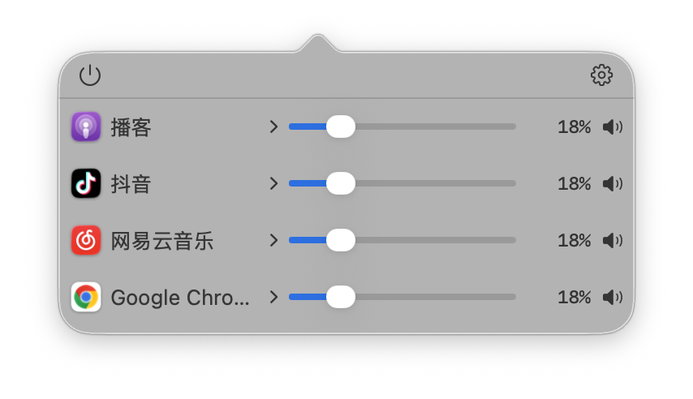
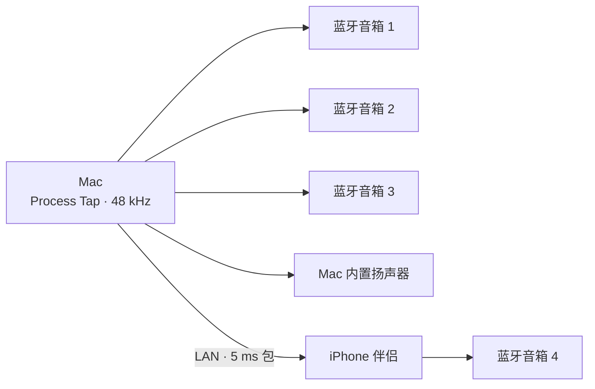
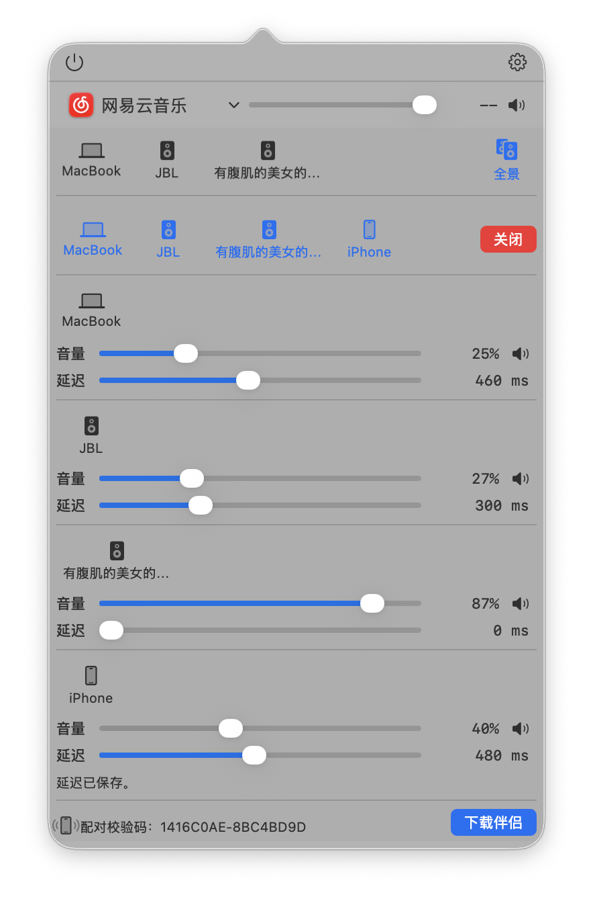
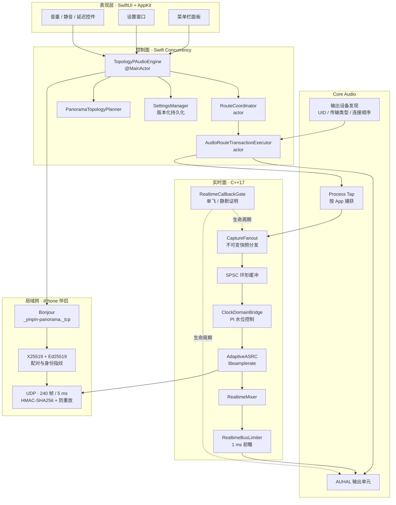
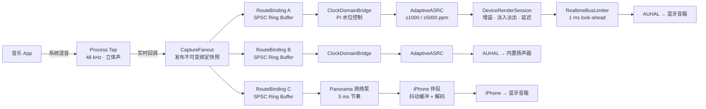
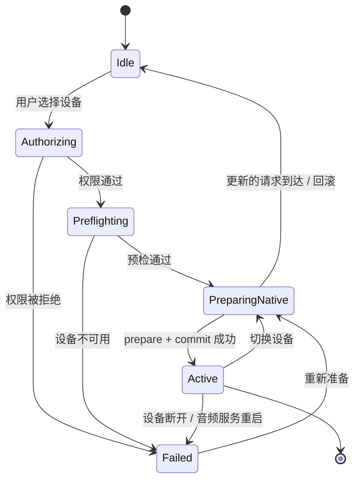
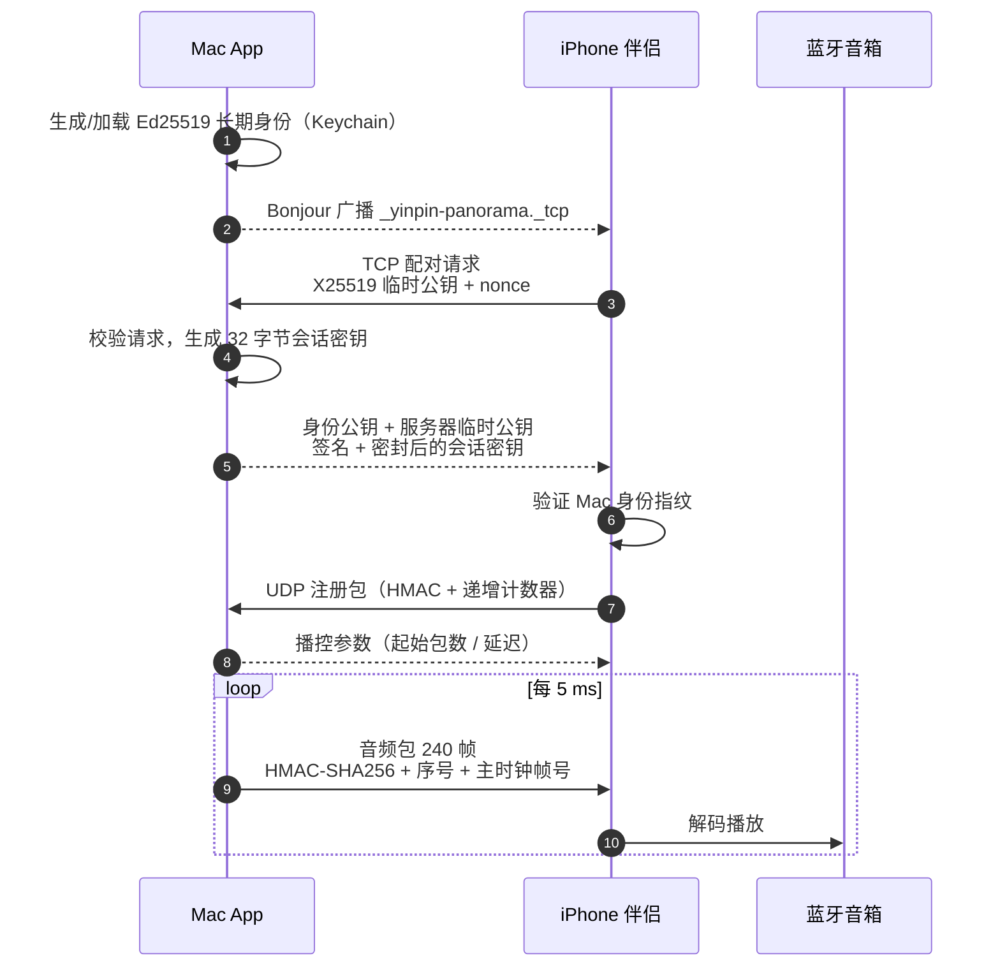

<p align="center">
  
</p>

<h1 align="center">音频切换 · Audio Switch</h1>

<p align="center">
  把家里吃灰的老蓝牙音箱，组成一套可独立控制的 Mac 多房间音频系统。
</p>

<p align="center">
  简体中文 | <a href="README.en.md">English</a>
</p>

<p align="center">
  
  
  
  
  <a href="LICENSE"></a>
  <a href="https://github.com/feijinloeng/audio-switch/actions/workflows/ci.yml"></a>
</p>

---

## 一分钟了解

音频切换是一个 macOS 实时音频路由系统：它用 **Core Audio Process Tap** 按 App 捕获声音，经过一套自己写的 **C++17 实时音频核心**（无锁环形缓冲、PI 时钟域校正、自适应重采样、总线限幅），再同时送到最多 **5 个输出端**——3 台 Mac 直连蓝牙音箱、Mac 内置扬声器、以及 1 台通过局域网桥接的 iPhone。

它解决的是一个很具体的硬件问题：老蓝牙音箱只支持 A2DP，没有 AirPlay，也没有 Wi-Fi，但它们本身还能正常发声。

| 工程维度 | 实现 |
| --- | --- |
| **语言** | Swift 5.9+ / SwiftUI + C++17 实时核心 |
| **规模** | 75 个 Swift 文件、19 个 C++ 文件，约 1.8 万行自研代码 |
| **实时约束** | 音频回调内零分配、零锁、零日志、零阻塞 |
| **时钟同步** | 每设备独立 PI 控制器 + libsamplerate 自适应重采样 |
| **路由模型** | prepare → commit → rollback 事务，切换失败不影响当前播放 |
| **安全** | X25519 配对、Ed25519 身份指纹、HMAC-SHA256 音频包、防重放计数器 |
| **质量** | 22 个单元测试 + GitHub Actions 双平台 Debug/Release 构建（strict concurrency） |

## 目录

- [这是什么](#这是什么)
- [核心能力](#核心能力)
- [界面](#界面)
- [技术架构](#技术架构)
- [工程难点与取舍](#工程难点与取舍)
- [质量保障](#质量保障)
- [隐私与安全](#隐私与安全)
- [安装](#安装)
- [从源码构建](#从源码构建)
- [项目结构](#项目结构)
- [已知边界](#已知边界)
- [路线图](#路线图)
- [参与贡献](#参与贡献)
- [许可证与第三方](#许可证与第三方)

## 这是什么

> 这个工具专门用于拯救你的老旧蓝牙音响，让那些放在家里吃灰的音响重新用起来。

### 项目初衷

音频切换面向这一类设备：

1. 只能使用老式 **A2DP**（蓝牙立体声音频传输标准）解码。
2. 没有 AirPlay，也没有 Wi-Fi 音频能力。
3. 设备本身还能正常发声，只是缺少新的连接方式。

本项目不以 AirPlay 为目标，也不采用 AirPlay 那种通过无线局域网组网的方式，而是直接为这些老设备提供一套继续使用的办法。

### 你可以用它做什么

1. **按 App 路由**：电脑同时运行多个音乐 App，把每个 App 的声音分别发送到指定输出设备。
2. **不同设备播放不同内容**：例如让音乐 App A 播放到音箱 1，让音乐 App B 播放到音箱 2。
3. **全景播放**：把多个输出设备组成一个播放组，共同播放同一份音频，获得更有空间感的 3D 环绕听感。
4. **扩展输出**：Mac 最多直连 3 台蓝牙音箱，还可以使用 Mac 自带扬声器和 1 路 iPhone 桥接输出。

## 核心能力

| 能力 | 说明 |
| --- | --- |
| 按 App 路由 | 为不同音乐 App 选择不同输出设备，独立调节音量和静音。 |
| 全景播放 | 最多组织 3 台蓝牙音响、Mac 自带扬声器和 1 路 iPhone 输出，共 5 个输出点共同播放同一份音频。 |
| 时钟校正 | 每个输出设备独立跟踪缓冲水位，降低长时间播放后的漂移和断流。 |
| 手动延迟对齐 | 每个输出端可单独设置 0–1000 ms 延迟，补偿蓝牙音箱之间的解码差异。 |
| iPhone 伴侣 | 将 iPhone 作为同一局域网内的额外播放端，桥接第 4 台蓝牙音箱。 |
| 热插拔 | 播放过程中增减音箱或连接/断开 iPhone，尽量保持其他设备不断声。 |
| 防爆音 | 淡入淡出、增益斜坡和总线限幅，减少切换时的突然爆音。 |
| 系统默认透传 | 当 App 使用系统默认输出且音量为 100% 时，不介入音频链路，避免无谓的延迟和资源占用。 |

### 输出能力一览

| 输出位置 | 数量 | 连接方式 |
| --- | ---: | --- |
| Mac 直连蓝牙音箱 | 最多 3 台 | Mac 蓝牙 + A2DP |
| Mac 自带扬声器 | 1 路 | Mac 内置音频输出 |
| iPhone 桥接音箱 | 1 台 | Mac → 局域网 → iPhone → 蓝牙音箱 |
| **同时发声的输出点** | **最多 5 个** | 3 台蓝牙音箱 + Mac 扬声器 + 1 台 iPhone 桥接音箱 |



## 界面

### 按 App 路由

每个 App 都可以单独选择输出设备、调节音量和静音。

<p align="center">
  
</p>

### 全景播放

全景模式下，可以为每个输出端单独设置音量和延迟，并在播放过程中加入或移除设备。

<p align="center">
  
</p>

## 技术架构

完整设计说明见 [docs/ARCHITECTURE.md](docs/ARCHITECTURE.md)。

### 系统分层



### 一次播放的数据通路



关键点：

1. **一次捕获，多路分发。** `CaptureFanout` 把一个 Process Tap 回调分发给 N 个 `RouteBinding`，每个绑定拥有独立的 SPSC 环形缓冲，互不阻塞。
2. **每个输出独立校时。** 蓝牙、内置扬声器、网络伴侣的消费速率都不同，`ClockDomainBridge` 根据缓冲水位算出重采样比例，`AdaptiveASRC` 在回调内完成转换。
3. **网络端只做传输。** iPhone 端收到的是 48 kHz / 16-bit / 立体声 PCM，240 帧一个包，自带抖动缓冲与播放水位控制。

### 缓冲与起播

| 输出类型 | 预滚 / 起播 | 设计目的 |
| --- | ---: | --- |
| 有线 / 内置 | 40 ms | 低延迟优先 |
| 蓝牙 | 171 ms | 吸收路由切换后传输层的短暂停顿 |
| 全景本地输出 | 1 s | 共享 48 kHz 时间轴，并留出手动延迟空间 |
| iPhone 伴侣 | 200 包 = 1 s | 网络抖动缓冲，上限 260 包（1.3 s） |

### 路由事务状态机

切换输出设备不是"改一个变量"，而是一次带回滚的事务。旧路由在新路由真正提交之前一直保持可用。



`AudioRouteTransactionExecutor` 的关键约束：

- 同一 App 的并发请求按 `requestID` 收敛，旧事务在安全边界回滚。
- 新路由 `commit` 成功后，旧路由才被释放；失败则保持原路由。
- HAL 服务重启会推进 `halEpoch`，所有旧 epoch 的异步完成都会被拒绝。

### iPhone 伴侣协议



协议细节：

| 项目 | 设计 |
| --- | --- |
| 发现 | Bonjour `_yinpin-panorama._tcp`，TXT 记录携带端口和协议版本 |
| 配对 | X25519 临时密钥协商；Mac 用 Ed25519 长期身份签名；会话密钥端到端密封 |
| 身份校验 | Mac 公钥指纹可在界面上人工比对，防止局域网中间人 |
| 音频包 | 240 帧 × 2 声道 × 16-bit = 960 B PCM；头部含 `sessionID`、`sequence`、`masterFrame` |
| 完整性 | HMAC-SHA256 截断 16 B；认证失败直接丢弃，不进入抖动缓冲 |
| 防重放 | 注册包带单调递增计数器，计数器参与 HMAC；主机只接受严格更大的值 |
| 接管保护 | 当前伴侣持续发送心跳时，新的配对请求会被拒绝（10 s 宽限期） |
| 恢复 | 中断、路由变化、引擎重配置、UDP 失败分别映射到不同的恢复动作 |

### 实时核心模块

| 模块 | 职责 | 实时约束 |
| --- | --- | --- |
| `RealtimeRingBuffer` | 立体声 Float32 SPSC 环形缓冲 | 只在创建时分配；读写无锁、无日志 |
| `CaptureFanout` | 持有不可变绑定快照，一次回调分发多路 | 发布/确认由控制面串行化 |
| `ClockDomainBridge` | PI 控制器，把缓冲水位误差转成 ppm 修正 | 稳态 ±1000 ppm，恢复态 ±5000 ppm，斜率 5000 ppm/s |
| `AdaptiveASRC` | 按比例做采样率转换 | 使用预分配状态与 scratch，无分配 |
| `DeviceRenderSession` | 单设备渲染：混音、增益、淡入淡出、延迟 | 回调内只读快照 |
| `RealtimeMixer` | 多路绑定混音 | 源数量为 0 时显式写静音 |
| `RealtimeBusLimiter` | 总线峰值限制 | 固定 1 ms 前瞻，增益平滑斜坡 |
| `RealtimeCallbackGate` | 单飞回调准入与静默证明 | 关闭后不再有任何回调能触碰共享状态 |

### 技术栈

| 层 | 技术 |
| --- | --- |
| UI | SwiftUI、AppKit（`NSStatusItem` 菜单栏）、Observation |
| 并发 | Swift Concurrency（actor / @MainActor / Task）、complete concurrency checking |
| 音频接入 | Core Audio HAL、Process Tap、AUHAL、AudioHardware Aggregate Device |
| 实时处理 | C++17、libsamplerate 0.2.2（sinc 转换器） |
| 网络 | Network.framework（Bonjour、TCP、UDP）、CryptoKit（X25519 / Ed25519 / HMAC-SHA256） |
| 持久化 | 版本化 JSON 设置存储、Keychain（长期配对身份） |
| 工程 | Swift Package Manager + Xcode 双工程、GitHub Actions、shell 发版脚本 |

### 代码规模

```text
Swift     75 个文件   约 15,000 行   Mac App / iPhone 伴侣 / 测试
C++       19 个文件   约  3,000 行   实时音频核心（不含 libsamplerate）
测试      22 个用例                 实时核心 / 路由事务 / 协议 / 配置持久化
```

## 工程难点与取舍

### 1. 蓝牙时钟漂移

每台蓝牙音箱的晶振都略有差异，长时间播放后缓冲会逐渐被抽干或撑爆。做法是：

1. 为每个输出维护独立的缓冲水位目标。
2. PI 控制器把水位误差转换为采样率修正（稳态 ±1000 ppm）。
3. 自适应重采样器执行修正，而不是靠丢帧/补帧。
4. 恢复态允许 ±5000 ppm，并以 5000 ppm/s 平滑过渡，避免可听见的音高跳变。

### 2. 热插拔不能打断其他设备

新增或移除一台音箱时，只重建受影响的输出快照。`OutputRenderSnapshotState` 记录当前渲染借用的绑定 token，只有确实被借用的绑定才会触发快照替换；未被影响的设备保持自己的 ASRC 状态，不会重置。

### 3. 切换时的爆音

三层防护：

1. 静音不是硬切 0，而是连续增益斜坡。
2. 设备渲染会话做淡入淡出。
3. 总线限幅器用 1 ms 前瞻压制瞬态。

### 4. 蓝牙带宽的硬上限

这不是软件能突破的限制。Mac 蓝牙芯片同时承载的 A2DP 流有限，实测 2 台音箱 + 蓝牙鼠标通常稳定，3 台则可能抖动。因此第 4 台音箱走 iPhone 桥接，而不是让 Mac 直连 4 台。

### 5. 实时线程的内存生命周期

实时回调不能分配、加锁、打日志。所有缓冲和状态在 prepare 阶段分配；回调只操作不可变快照。`RealtimeCallbackGate` 提供"关闭后等待回调退出"的静默证明，确保释放内存时没有回调仍在借用。

### 6. 局域网音频的安全边界

配对请求来自未认证的局域网设备，因此：

- 会话密钥从不落盘。
- 音频包在进入抖动缓冲前先验 HMAC。
- 注册包带单调计数器，抓包重放无效。
- 当前伴侣仍在心跳时，新设备不能抢占端点。

## 质量保障

| 手段 | 内容 |
| --- | --- |
| 单元测试 | 22 个用例，覆盖环形缓冲、回调门、增益斜坡、路由事务回滚、HAL 重启、配置损坏隔离、协议认证、防重放、接管策略 |
| 并发检查 | 全项目开启 `-strict-concurrency=complete` |
| CI | GitHub Actions 在 macOS 26 上跑 Swift 测试，并分别以 Debug / Release 构建 Mac App 和 iPhone 伴侣（无签名） |
| 协议测试 | 篡改音量、伪造计数器、错误 session 等负向用例 |
| 持久化测试 | 损坏文件隔离、未来版本只读、后台加载与前台修改合并 |

```bash
swift test -Xswiftc -strict-concurrency=complete
```

## 隐私与安全

1. **音频不落盘、不上传。** 所有处理在本机实时完成，不录制、不保存、不经过任何服务器。
2. **设置只在本机。** 音量、静音、设备偏好和路由配置保存在这台 Mac。
3. **密钥分级。** Mac 长期配对身份存放在系统 Keychain；每次连接的临时会话密钥只在内存中，断开即清除。
4. **无第三方 SDK。** 当前版本不接入广告、统计或崩溃分析服务。
5. **最小权限。** 沙盒开启，只申请音频输入、网络客户端/服务端权限。

发现安全问题请不要开公开 Issue，按 [SECURITY.md](SECURITY.md) 的方式私下报告。

## 安装

当前仓库以源码形式公开。预编译安装包由 `Scripts/release.sh` 生成：Developer ID 签名 → Apple 公证 → 装订票据 → dmg/zip → `SHA256SUMS.txt`。产物发布后可在 [Releases](https://github.com/feijinloeng/audio-switch/releases) 下载。

如果 Releases 中还没有可用版本，请直接按下面的[从源码构建](#从源码构建)运行。

- 系统要求：macOS 14.2 或更高版本
- 架构：Apple 芯片（arm64）

### iPhone 伴侣

伴侣 App 的源码在 `Sources/音频切换伴侣`，不上架 App Store。用 Xcode 选择 `音频切换伴侣` scheme，构建到与 Mac 处于同一局域网的 iPhone 即可。

## 从源码构建

只需要使用的话，构建完成后把 `音频切换.app` 拖进「应用程序」文件夹。

### 1. 准备环境

- macOS 14.2 或更高版本
- Xcode（完整构建 Mac App 和 iPhone 伴侣）
- Swift 5.9 或更高版本

### 2. 获取代码

```bash
git clone https://github.com/feijinloeng/audio-switch.git
cd audio-switch
```

### 3. 运行测试

```bash
swift test -Xswiftc -strict-concurrency=complete
```

### 4. 构建并启动 Mac App

```bash
Scripts/build_and_run.sh
```

需要跟踪调试日志时：

```bash
Scripts/build_and_run.sh --logs
```

### 5. 使用 Xcode

也可以直接用 Xcode 打开 `音频切换.xcodeproj`。工程包含两个共享 Scheme：

1. Mac App。
2. iPhone 伴侣 App。

首次运行时，系统会请求以下权限：

- 音频捕获：获取指定 App 的声音。
- 本地网络：连接 iPhone 伴侣设备。

## 项目结构

```text
.
├── .github/                    CI、Issue 模板、PR 模板
├── Configuration/              Info.plist 与沙盒权限
├── RealtimeCore/               C++17 实时音频核心
│   ├── include/                对外 C 头文件
│   └── Vendor/libsamplerate/   第三方重采样器源码
├── Sources/
│   ├── 音频切换/               Mac App（75 个 Swift 文件）
│   │   ├── App/                UI 与后端协调器
│   │   ├── Routing/            路由事务与时钟桥接后端
│   │   ├── TopologyP/          Process Tap / AUHAL / ASRC 适配
│   │   ├── CoreAudio/          HAL、设备发现、进程归属解析
│   │   ├── Companion/          局域网伴侣主机与配对协议
│   │   ├── Domain/             拓扑规划、路由状态、审批策略
│   │   ├── Settings/           版本化配置与启动项
│   │   └── Views/              菜单栏、设置、设计系统
│   └── 音频切换伴侣/           iPhone 伴侣 App
├── Tests/                      22 个单元测试
├── Scripts/                    本地构建与发版脚本
└── docs/                       架构文档与界面截图
```

## 已知边界

这是 Mac 蓝牙硬件和系统带来的边界，不是软件可以无限突破的限制。

### 为什么有上限

1. Mac 蓝牙芯片的无线带宽有限。
2. 每台蓝牙音箱都会占用一条 A2DP 音频流。
3. 鼠标等 BLE（低功耗蓝牙）设备也会参与无线调度，可能进一步挤占资源。

### 实测结论

1. **2 台蓝牙音箱 + 蓝牙鼠标**：通常可以正常工作。
2. **3 台蓝牙音箱 + 蓝牙鼠标**：可能出现音爆、杂音或播放抖动。
3. **最可靠的 3 音箱配置**：Mac 只连接 3 台蓝牙音箱，关闭鼠标和其他不必要的蓝牙设备。

### 第 4 台蓝牙音箱怎么接

让 Mac 直接通过蓝牙连接 4 台音箱时，必然会有 1 台断连。这是 Mac 蓝牙芯片对 A2DP 音频流的限制，不是本软件的限制。因此第 4 台音箱不能由 Mac 直接连接，只能通过 iPhone 伴侣 App 桥接：

1. Mac 直连 3 台蓝牙音箱。
2. Mac 通过局域网把音频发送给 iPhone。
3. iPhone 再通过蓝牙连接第 4 台音箱。

如果把 Mac 自带扬声器也算作一个发声位置，最多就是 **5 个同时输出点**。

### 延迟

全景模式会先积累一段音频再开始播放（基础预滚约 1 秒），因此更适合听音乐，不适合看视频或玩需要低延迟的游戏。

## 路线图

- [ ] 输出端响度校准（按设备做增益归一化）
- [ ] 全景分组的导入 / 导出
- [ ] 更细粒度的设备健康诊断面板
- [ ] Apple Silicon 之外的构建产物
- [ ] 英文界面完整本地化

## 参与贡献

欢迎反馈以下内容：

1. 设备兼容性问题。
2. 音箱同步体验。
3. 崩溃或播放异常。

提交 Issue 前请先看 [CONTRIBUTING.md](CONTRIBUTING.md)。也欢迎提交 Pull Request。提交代码前，请至少运行：

```bash
swift test -Xswiftc -strict-concurrency=complete
```

如果改动了 Xcode 工程或 App 配置，还请分别验证 Mac App 和 iPhone 伴侣可以无签名构建。

## 许可证与第三方

本项目主代码使用 [MIT License](LICENSE)。

`RealtimeCore/Vendor/libsamplerate` 使用 libsamplerate 源码，遵循该目录下的 BSD 两条款许可证。

版本变化记录在 [CHANGELOG.md](CHANGELOG.md)。
