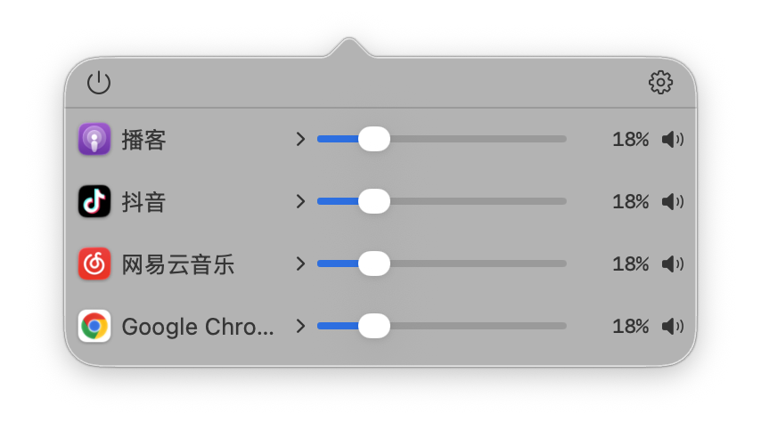
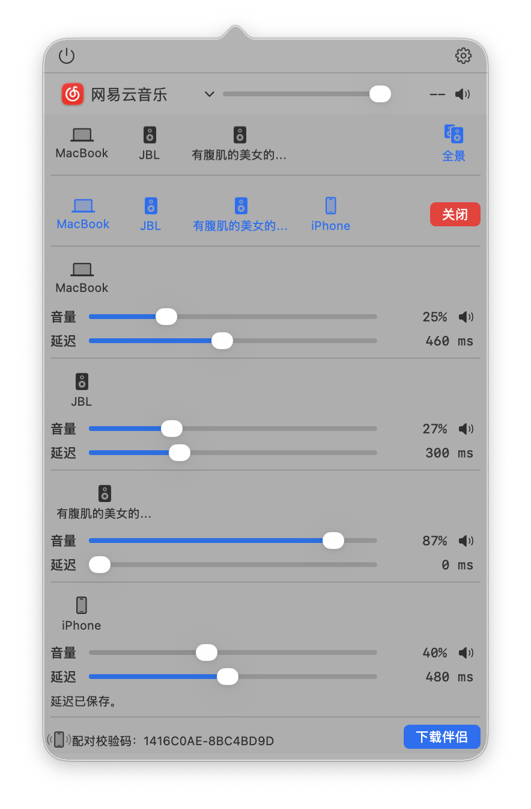
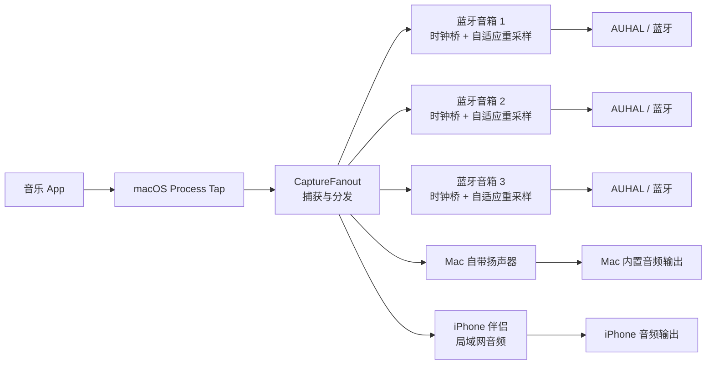

<p align="center">
  
</p>

<h1 align="center">音频切换</h1>

<p align="center">
  让老旧的蓝牙音箱，重新组成一个声音系统。
</p>

<p align="center">
  
  
  <a href="LICENSE"></a>
</p>

## 这是什么

> 这个工具专门用于拯救你的老旧蓝牙音响，让那些放在家里吃灰的音响重新用起来。

### 项目初衷

音频切换专门面向这一类设备：

1. 只能使用老式 **A2DP（蓝牙立体声音频传输标准）** 解码。
2. 没有 AirPlay，也没有 Wi-Fi 音频能力。
3. 设备本身还能正常发声，只是缺少新的连接方式。

本项目不以 AirPlay 为目标，也不采用 AirPlay 那种通过无线局域网组网的方式，而是直接为这些老设备提供一套继续使用的办法。

### 你可以用它做什么

1. **按 App 路由**：电脑同时运行多个音乐 App，把每个 App 的声音分别发送到指定输出设备。
2. **不同设备播放不同内容**：例如让音乐 App A 播放到音箱 1，让音乐 App B 播放到音箱 2。
3. **全景播放**：把多个输出设备组成一个播放组，共同播放同一份音频，获得更有空间感的 3D 环绕听感。
4. **扩展输出**：Mac 最多直连 3 台蓝牙音箱，还可以使用 Mac 自带扬声器和 1 路 iPhone 桥接输出。

## 主要能力

| 能力 | 说明 |
| --- | --- |
| 按 App 路由 | 为不同音乐 App 选择不同输出设备，独立调节音量和静音。 |
| 全景播放 | 最多组织 3 台蓝牙音响、Mac 自带扬声器和 1 路 iPhone 输出，共 5 个输出点共同播放同一份音频。 |
| 时钟校正 | 每个输出设备独立跟踪缓冲水位，降低长时间播放后的漂移和断流。 |
| iPhone 伴侣 | 将 iPhone 作为同一局域网内的额外播放端，桥接第 4 台蓝牙音箱。 |
| 热插拔 | 播放过程中增减音箱或连接/断开 iPhone，尽量保持其他设备不断声。 |
| 防爆音 | 使用淡入淡出、增益斜坡和总线限幅，减少切换时的突然爆音。 |

### 输出能力一览

| 输出位置 | 数量 | 连接方式 |
| --- | ---: | --- |
| Mac 直连蓝牙音箱 | 最多 3 台 | Mac 蓝牙 + A2DP |
| Mac 自带扬声器 | 1 路 | Mac 内置音频输出 |
| iPhone 桥接音箱 | 1 台 | Mac → 局域网 → iPhone → 蓝牙音箱 |
| **同时发声的输出点** | **最多 5 个** | 3 台蓝牙音箱 + Mac 扬声器 + 1 台 iPhone 桥接音箱 |

## 实际界面

### 按 App 路由

每个 App 都可以单独选择输出设备、调节音量和静音。

<p align="center">
  
</p>

### 全景播放

全景模式下，可以为每个输出端单独设置音量和延迟，并在播放过程中加入或移除设备。

<p align="center">
  
</p>

## 音频是怎样流动的

一次播放大致经过以下步骤：

1. 音乐 App 把声音交给 macOS 音频系统。
2. `Process Tap`（macOS 的音频捕获接口）捕获音频，`CaptureFanout` 将同一份音频分发给多个输出端。
3. 每个输出端独立进行缓冲、时钟校正和自适应重采样。
4. 音频分别交给蓝牙音箱、Mac 自带扬声器或 iPhone 伴侣播放。



> 全景模式会先积累一段音频再开始播放，因此更适合听音乐，不适合看视频或玩需要低延迟的游戏。

## 已知边界

这是 Mac 蓝牙硬件和系统带来的边界，不是软件可以无限突破的限制。

### 为什么有上限

1. Mac 蓝牙芯片的无线带宽有限。
2. 每台蓝牙音箱都会占用一条 A2DP 音频流。
3. 鼠标等 BLE（低功耗蓝牙）设备也会参与无线调度，可能进一步挤占资源。

### 我们的测试结论

1. **2 台蓝牙音箱 + 蓝牙鼠标**：通常可以正常工作。
2. **3 台蓝牙音箱 + 蓝牙鼠标**：可能出现音爆、杂音或播放抖动。
3. **最可靠的 3 音箱配置**：Mac 只连接 3 台蓝牙音箱，关闭鼠标和其他不必要的蓝牙设备。

### 第 4 台蓝牙音箱怎么接

我们已经测试过：如果让 Mac 直接通过蓝牙连接 4 台音箱，必然会有 1 台断连。这是 Mac 蓝牙芯片对 A2DP 音频流的限制，不是本软件的限制。因此，第 4 台音箱不能由 Mac 直接连接，只能通过 iPhone 伴侣 App 桥接：

1. Mac 直连 3 台蓝牙音箱。
2. Mac 通过局域网把音频发送给 iPhone。
3. iPhone 再通过蓝牙连接第 4 台音箱。

因此，目前最多可以实现 **4 台蓝牙音箱同时输出**。

如果把 Mac 自带扬声器也算作一个发声位置，最多就是 **5 个同时输出点**：

1. 3 台 Mac 直连的蓝牙音箱。
2. 1 路 Mac 自带扬声器。
3. 1 台由 iPhone 桥接的蓝牙音箱，或者由 iPhone 自带扬声器。

## 当前发布版本

| App | 版本 | 构建号 |
| --- | --- | --- |
| 音频切换（Mac） | 1.3 | 2 |
| 音频切换伴侣（iPhone） | 1.2 | 1 |

## 快速开始

### 1. 准备环境

- macOS 14.2 或更高版本
- Xcode（完整构建 Mac App 和 iPhone 伴侣）
- Swift 5.9 或更高版本

### 2. 获取代码

```bash
git clone <你的仓库地址>
cd <仓库目录>
```

### 3. 运行测试

```bash
swift test -Xswiftc -strict-concurrency=complete
```

### 4. 构建并启动 Mac App

```bash
Scripts/build_and_run.sh
```

需要跟踪调试日志时：

```bash
Scripts/build_and_run.sh --logs
```

### 5. 使用 Xcode

也可以直接用 Xcode 打开 `音频切换.xcodeproj`。工程包含两个共享 Scheme：

1. Mac App。
2. iPhone 伴侣 App。

首次运行时，系统会请求以下权限：

- 音频捕获：获取指定 App 的声音。
- 本地网络：连接 iPhone 伴侣设备。

## 项目结构

### 主要目录

```text
.github/                         GitHub Actions 持续集成配置
Configuration/                   Info.plist 与权限配置
RealtimeCore/                    C/C++ 实时音频处理核心
RealtimeCore/Vendor/             第三方采样率转换器源码
Sources/音频切换/                Mac App 源码和资源
Sources/音频切换伴侣/            iPhone 伴侣源码和资源
Tests/                           Swift 与实时核心单元测试
Scripts/                         本地构建、运行和日志脚本
```

### 实时音频核心

实时核心的关键模块包括：

1. `ClockDomainBridge`：跟踪每个设备的时钟漂移。
2. `AdaptiveASRC`：根据目标设备采样率做自适应重采样。
3. `CaptureFanout`：把一次捕获安全地分发到多个输出端。
4. `DeviceRenderSession`：完成单个设备的渲染、增益和延迟处理。
5. `RealtimeBusLimiter`：限制混音总线峰值，减少削波和爆音。

## 权限与安全

### 不需要提交密钥

本仓库不需要任何密钥才能编译和运行测试。

以下文件或信息不要提交：

1. Apple 签名证书和 Provisioning Profile。
2. App Store Connect `.p8` 私钥。
3. GitHub Token 和 SSH 私钥。
4. 本机发布记录、构建产物和 Xcode 本地状态文件。

签名信息应保存在本机钥匙串中；自动化构建需要时，使用 GitHub Actions Secrets。

工程不固定任何个人 Apple 开发团队。需要在 Xcode 中签名运行或发布时，请选择你自己的 Team 和证书。

### 公开前检查

项目的 `.gitignore` 已排除常见的密钥文件和本地文件。公开仓库前，建议再检查一次：

1. `git diff` 中没有个人信息或敏感配置。
2. GitHub 的 Secret scanning 没有发出警告。
3. 仓库中没有证书、私钥或真实设备配对信息。

## 参与贡献

欢迎反馈以下内容：

1. 设备兼容性问题。
2. 音箱同步体验。
3. 崩溃或播放异常。

也欢迎提交 Pull Request。提交代码前，请至少运行：

```bash
swift test -Xswiftc -strict-concurrency=complete
```

如果改动了 Xcode 工程或 App 配置，还请分别验证 Mac App 和 iPhone 伴侣可以无签名构建。

## 第三方组件

`RealtimeCore/Vendor/libsamplerate` 使用 libsamplerate 源码。

- 这是独立的第三方组件。
- 遵循该目录下的 BSD 两条款许可证。

## 许可证

本项目主代码使用 [MIT License](LICENSE)。

你可以自由使用、修改和分发本项目，但请保留原许可证和版权声明。
