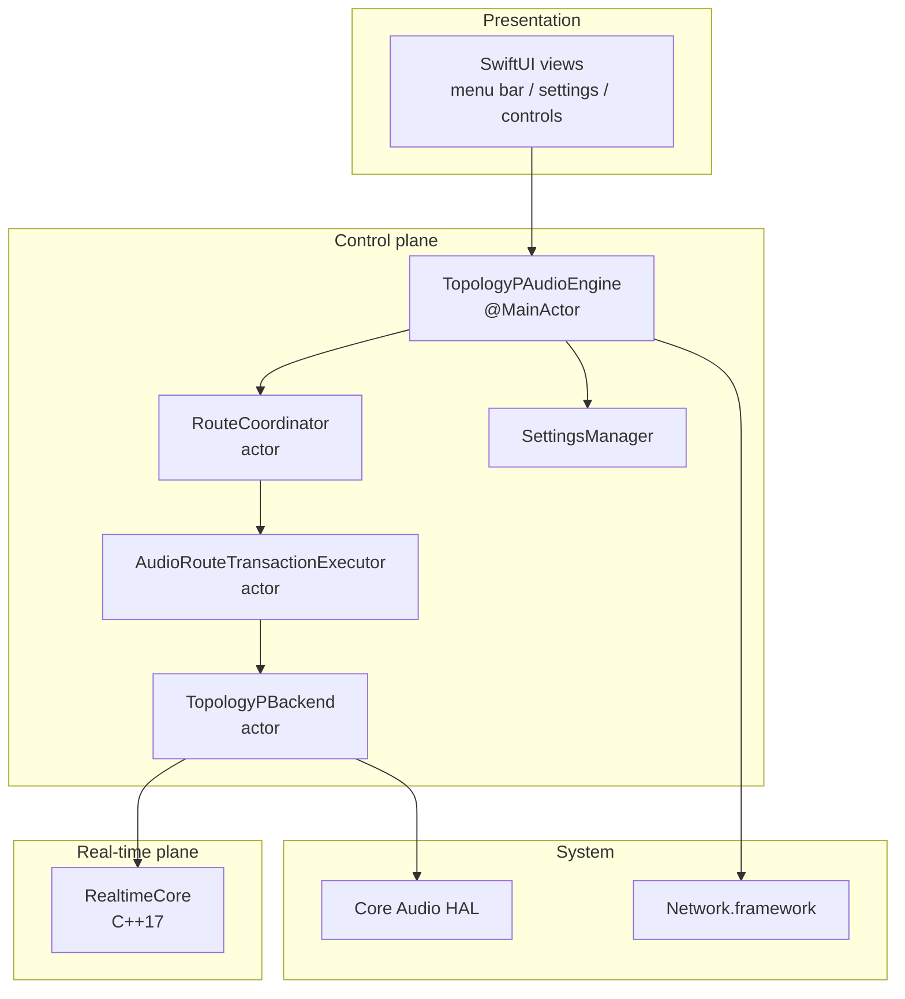
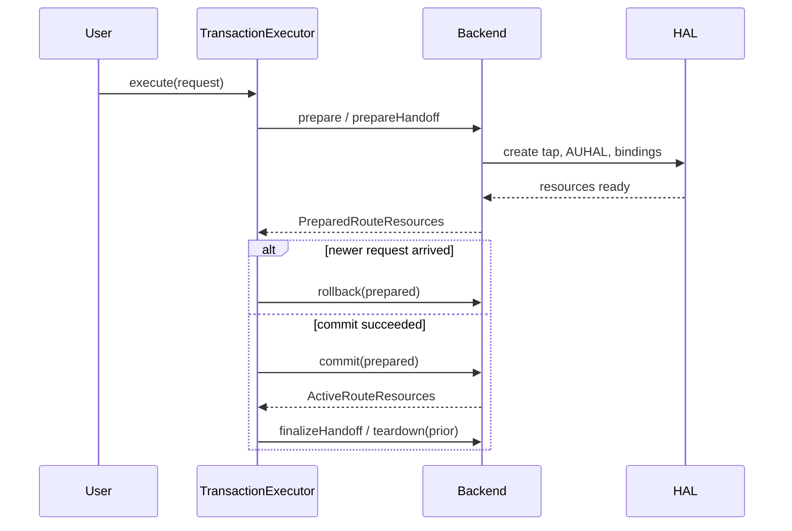

# Architecture

This document describes the internals, real-time constraints, and key trade-offs of Audio Switch. It is written for developers reading or contributing to the codebase.

> 中文版：[ARCHITECTURE.md](ARCHITECTURE.md)

## 1. Goals

| Goal | Meaning |
| --- | --- |
| Per-app isolation | Every app has independent output, volume, and mute state |
| Multi-output sync | The same audio stays perceptually coherent across five endpoints |
| Undisturbed playback | Switching devices, hot-plugging, or network jitter should not silence other outputs |
| Real-time safety | No allocation, locking, logging, or blocking inside audio callbacks |
| Rollback | A failed new route leaves the old route usable |
| Least privilege | Sandboxed; audio capture and local network requested only when needed |

## 2. Layers



1. **Presentation** reads `@Observable` state and turns user intent into route requests. It never touches Core Audio directly.
2. **Control plane** is entirely actor- or `@MainActor`-isolated and owns state machines, transactions, persistence, and permissions.
3. **Real-time plane** is pure C++17 with no Swift runtime dependency, no exceptions, and no allocation.
4. **System layer** is reached only through public Core Audio and Network.framework APIs.

## 3. Control plane

### 3.1 `TopologyPAudioEngine`

The `@MainActor` façade. It:

- Translates HAL snapshots into stable `AppIdentity` / `OutputDeviceDescriptor` values.
- Tracks a request token per app and discards stale callbacks.
- Coordinates local and network outputs for a panorama group.
- Keeps the user's panorama choice when the companion disconnects and falls back to a safe local route.

### 3.2 `RouteCoordinator`

The per-app control-plane state machine:

```text
idle → authorizing → preflighting → preparingNative → active
                                  ↘ failed
```

- Every request carries a `requestID`; async completions from older requests are rejected.
- `halEpoch` advances when the audio service restarts, invalidating older commits.
- It owns no Core Audio resources — only state transitions.

### 3.3 `AudioRouteTransactionExecutor`

The transaction boundary for device switching:



Invariants:

1. One pending transaction per app.
2. Repeated clicks on the same target reuse the active route instead of rebuilding it.
3. The previous route is released only after the new route commits.
4. A failure at any stage rolls back, leaving current playback untouched.

### 3.4 Snapshot lifetime

Real-time callbacks borrow binding pointers, so the control plane cannot free them at will. Two layers prove safety:

1. `CaptureFanout` publishes immutable binding snapshots with a generation counter.
2. `RealtimeCallbackGate` provides single-flight admission and an idle acknowledgement.

`OutputRenderSnapshotState` records which binding tokens the current render snapshot actually borrows. When a device is removed, only genuinely borrowed tokens trigger a snapshot replacement; unaffected devices keep their ASRC state and avoid a reset-induced pop.

## 4. Real-time plane

### 4.1 Callback contract

Anything running on the real-time thread must:

- Never call `malloc/new` or `free/delete`.
- Never use mutexes, semaphores, or condition variables.
- Never touch files, sockets, logging, Objective-C, or the Swift runtime.
- Never throw or block.
- Only read and write preallocated memory and immutable snapshots.

`RealtimeCallbackGate` enforces this contract at runtime: once closed, new callbacks are rejected; `close_and_wait` waits for the admitted callback to leave, after which freeing memory is safe.

### 4.2 Modules and data flow

```text
Process Tap callback
      │
      ▼
CaptureFanout ──► RouteBinding A ──► RingBuffer ──► ClockBridge ──► ASRC ──┐
      │                                                                   ├─► Mixer ─► Limiter ─► AUHAL
      ├──────────► RouteBinding B ──► RingBuffer ──► ClockBridge ──► ASRC ─┤
      │                                                                   │
      └──────────► RouteBinding C ──► RingBuffer ──► ClockBridge ──► ASRC ─┘
```

### 4.3 Clock-domain correction

Each output has its own consumption clock. `ClockDomainBridge` takes the current fill level and produces a resampling ratio:

```text
error      = (currentFill - targetFill) / targetFill
integral  += error
ratio      = 1 + kp * error + ki * integral
```

Parameters in the code:

| Parameter | Value |
| --- | --- |
| Proportional gain `kp` | 0.05 |
| Integral gain `ki` | 0.001 |
| Steady-state correction | ±1000 ppm |
| Recovery correction | ±5000 ppm |
| Correction slew | 5000 ppm/s |

`AdaptiveASRC` applies the ratio with libsamplerate's sinc converter. It writes only into preallocated stereo storage, zeroes the remainder, and never allocates, locks, or logs.

### 4.4 Buffer profiles

Profiles are fixed during prepare and never adjusted from a callback.

| Profile | Capacity | Pre-roll | Target | Low | High |
| --- | ---: | ---: | ---: | ---: | ---: |
| Wired / built-in | 16,384 frames (341 ms) | 1,920 (40 ms) | 1,920 | 720 (15 ms) | 4,800 (100 ms) |
| Bluetooth | 131,072 frames (2.73 s) | 8,192 (171 ms) | 8,192 | 3,840 (80 ms) | 32,768 (683 ms) |
| Panorama | 262,144 frames (5.46 s) | 48,000 (1 s) | 48,000 | 24,000 (500 ms) | 96,000 (2 s) |

The Bluetooth profile is deliberately large: the hardware transport can briefly pause its render callback after a route change. The capacity absorbs that one-time burst so the Process Tap never drops program frames (which would be audible as distortion).

### 4.5 Manual delay

In panorama mode each endpoint can be delayed by 0–1000 ms. This is not a one-time pause; it raises the steady-state fill target:

```text
delayFrames = milliseconds × 48
preRoll' = preRoll + delayFrames
target'  = target  + delayFrames
low'     = low     + delayFrames
high'    = high    + delayFrames
```

The ASRC controller therefore preserves the offset after pre-roll instead of correcting it away.

### 4.6 Pop suppression

1. Mute is a continuous gain ramp, never a hard zero.
2. `DeviceRenderSession` fades the device bus in and out.
3. Each device bus is limited inside `DeviceRenderSession` with 1 ms look-ahead: a threshold near -0.5 dB, up to 12 dB of reduction, and a 50 ms release.
4. The network bus is limited separately before Int16 conversion with up to 48 dB of reduction, preventing clipping when multiple apps sum together.

## 5. iPhone companion protocol

### 5.1 Discovery and pairing

| Stage | Content |
| --- | --- |
| Discovery | Bonjour service `_yinpin-panorama._tcp`; TXT carries port and protocol version |
| Pairing request | Device name, output name, volume, X25519 ephemeral public key, client nonce |
| Pairing response | peerID, sessionID, UDP port, Mac long-term identity key, server ephemeral key, nonce, sealed session key, signature |
| Identity check | The iPhone verifies the signature and shows the Mac key fingerprint for manual comparison |

The Mac long-term identity is an Ed25519 key stored in the Keychain (`AfterFirstUnlockThisDeviceOnly`). The 32-byte session key lives only in memory.

### 5.2 Wire format

Control frame:

```text
magic "YPCF" (4) | version (1) | type (1) | payloadLength (4) | JSON payload
```

Audio packet:

```text
type (1) | version (1) | sessionID (16) | sequence (8) | masterFrame (8)
| PCM 960 B | truncated HMAC-SHA256 (16 B)
```

- 48 kHz, stereo, 16-bit.
- 240 frames per packet = 5 ms.
- 1,010 B per packet, roughly 202 KB/s or 1.6 Mbps.

### 5.3 Jitter buffer

| Parameter | Value |
| --- | --- |
| Startup | 200 packets (1 s) |
| Maximum | 260 packets (1.3 s) |
| First missing packet | Repeat the previous PCM block instead of going silent |
| Sustained loss | Fade out and re-enter startup buffering, locking onto the earliest available sequence |

### 5.4 Anti-replay and takeover

- Registration carries a `counter` that is part of the HMAC.
- The host accepts only counters strictly greater than the last accepted value.
- A passive listener cannot raise the counter without the session key.
- The active companion re-registers every 2 s. As long as an authenticated datagram arrived within the last 10 s, new pairing requests are refused.

## 6. Failure and recovery

| Event | Detection | Action |
| --- | --- | --- |
| Audio service restart | HAL listener | Advance `halEpoch`, invalidate old transactions, re-prepare |
| Device removal | Output snapshot diff | Affected app enters failed; other apps unaffected |
| Capture permission revoked | Permission query | State becomes failed; UI deep-links to System Settings |
| iPhone interruption ended | `AVAudioSession` notification | Reactivate audio when `shouldResume` |
| iPhone route change | Audio session notification | Reactivate audio |
| UDP connection failure | Network.framework state | Tear down and reconnect |
| Companion control connection lost | TCP state | Clear the session, mark the endpoint unavailable |
| Corrupt settings | JSON decode failure | Quarantine as `.corrupt` and notify the user |
| Settings from a newer version | `version > current` | Read-only; never overwrite |

## 7. Concurrency model

- UI and façade: `@MainActor`.
- Route state machine, transaction executor, backend: dedicated actors.
- Real-time callbacks: outside Swift concurrency, communicating through C APIs and atomics.
- The whole project builds with `-strict-concurrency=complete`; CI enforces it.
- Cross-actor value types are `Sendable`; HAL resources are wrapped in opaque tokens so `AudioObjectID` never leaks into domain state or persistence.

## 8. Testing strategy

| Test file | Coverage |
| --- | --- |
| `RealtimeCoreTests` | Ring-buffer capacity and wrap, callback-gate single-flight and quiescence, mute gain ramp |
| `RouteTransactionTests` | A newer request cancels and rolls back an older transaction |
| `RecoveryAndSnapshotTests` | Render snapshot replaced exactly once, re-prepare after HAL restart, no false reclamation proof on failure |
| `SettingsPersistenceTests` | Corrupt quarantine, future-version read-only, background-load merge |
| `PanoramaWireProtocolTests` | Tamper detection, authenticated counter, anti-replay, takeover policy, recovery policy, jitter buffer |

Tests do not require real Bluetooth hardware. Hardware-dependent behaviour is covered through policy objects and protocol-level tests; a real-device matrix supplements them before release.

## 9. Trade-offs and rejected alternatives

| Alternative | Why it was rejected |
| --- | --- |
| AirPlay-style networking | Old devices do not support it, and its latency does not fit the target use case |
| System aggregate device for mixing | No per-app volume control and no per-device clock correction |
| Fixed delay with frame drops/duplicates | Guaranteed drift over long playback; dropped frames are audible as pops |
| Shared memory with locks | Real-time threads cannot wait; locks introduce priority inversion and unpredictable latency |
| TCP for audio | Retransmission causes head-of-line blocking; real-time audio prefers loss over waiting |
| One global session key | Cannot isolate iPhones or prevent replay |

## 10. Glossary

| Term | Meaning |
| --- | --- |
| Process Tap | Per-process audio capture API introduced in macOS 14.2 |
| AUHAL | Audio Unit HAL output unit driving one physical device |
| ASRC | Asynchronous sample-rate conversion |
| SPSC | Single producer, single consumer |
| Pre-roll | Frames buffered before playback starts |
| Master frame | Shared 48 kHz timeline frame number for panorama playback |
| HAL epoch | Audio-service lifecycle counter that advances on restart |
