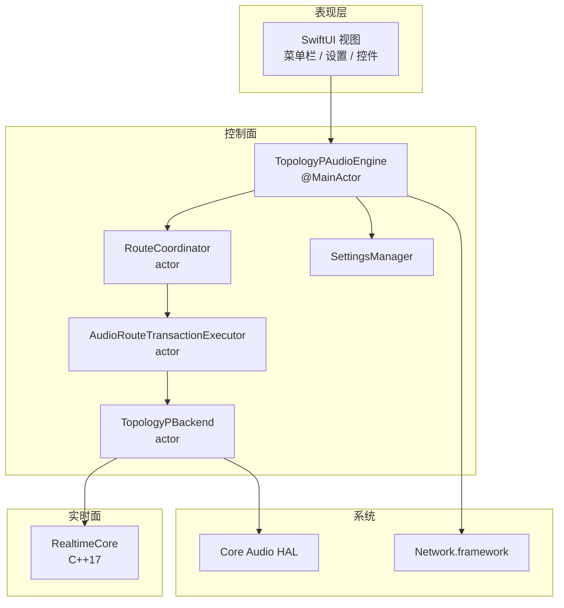
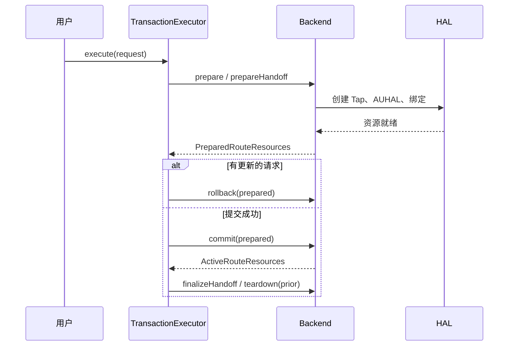

# 架构设计

本文记录音频切换的内部结构、实时约束和关键取舍。面向想读懂代码或参与贡献的开发者。

> English version: [ARCHITECTURE.en.md](ARCHITECTURE.en.md)

## 1. 设计目标

| 目标 | 含义 |
| --- | --- |
| 按 App 隔离音频 | 每个 App 的输出设备、音量、静音互相独立 |
| 多输出同步 | 同一份音频在 5 个输出点上保持可听的一致性 |
| 不打断播放 | 切换设备、热插拔、网络抖动时，其他输出尽量不断声 |
| 实时安全 | 音频回调内不分配、不加锁、不打日志、不阻塞 |
| 可回滚 | 新路由失败时，旧路由仍然可用 |
| 最小权限 | 沙盒、按需申请音频捕获与本地网络权限 |

## 2. 分层



### 各层职责

1. **表现层**只读 `@Observable` 状态，把用户操作翻译成路由请求，不直接接触 Core Audio。
2. **控制面**全部是 actor 或 `@MainActor`，负责状态机、事务、持久化和权限。
3. **实时面**是纯 C++17，不依赖 Swift 运行时，不抛异常、不分配内存。
4. **系统层**只通过 Core Audio 和 Network.framework 的公开 API 访问。

## 3. 控制面

### 3.1 `TopologyPAudioEngine`

`@MainActor` 的门面，负责：

- 把 HAL 快照翻译成稳定的 `AppIdentity` / `OutputDeviceDescriptor`。
- 维护每个 App 的路由请求 token，丢弃过期回调。
- 协调全景分组的本地输出与网络输出。
- 在伴侣断开时保留用户选择，并回退到安全的本地路由。

### 3.2 `RouteCoordinator`

单一 App 的控制面状态机：

```text
idle → authorizing → preflighting → preparingNative → active
                                  ↘ failed
```

- 每个请求带 `requestID`，过期请求的异步完成会被拒绝。
- `halEpoch` 在音频服务重启时递增，旧 epoch 的提交无效。
- 没有 Core Audio 资源所有权，只做状态判定。

### 3.3 `AudioRouteTransactionExecutor`

切换设备的事务边界：



约束：

1. 同一 App 同时只有一个待提交事务。
2. 相同目标设备的重复点击不会重建链路，直接复用当前路由。
3. 旧路由在新路由 `commit` 成功后才释放。
4. 任何阶段失败都会 `rollback`，当前播放不受影响。

### 3.4 快照生命周期

实时回调借用绑定指针，控制面不能随意释放。为此有两层证明：

1. `CaptureFanout` 发布不可变绑定快照，并维护 generation。
2. `RealtimeCallbackGate` 提供单飞准入和"已静默"确认。

`OutputRenderSnapshotState` 记录当前渲染快照实际借用的 binding token。移除设备时，只有确实被借用的 token 才触发快照替换；未受影响的设备保留自己的 ASRC 状态，避免重置造成的爆音。

## 4. 实时面

### 4.1 回调契约

所有进入实时线程的函数必须满足：

- 不调用 `malloc/new`、`free/delete`。
- 不使用互斥锁、信号量、条件变量。
- 不做文件、网络、日志、Objective-C 或 Swift 运行时调用。
- 不抛异常，不阻塞等待。
- 只读写预分配内存和不可变快照。

`RealtimeCallbackGate` 是这个契约的运行时保险：关闭后，新的回调会被拒绝；`close_and_wait` 会等到已准入的回调离开，之后释放内存才是安全的。

### 4.2 模块与数据流

```text
Process Tap 回调
      │
      ▼
CaptureFanout ──► RouteBinding A ──► RingBuffer ──► ClockBridge ──► ASRC ──┐
      │                                                                   ├─► Mixer ─► Limiter ─► AUHAL
      ├──────────► RouteBinding B ──► RingBuffer ──► ClockBridge ──► ASRC ─┤
      │                                                                   │
      └──────────► RouteBinding C ──► RingBuffer ──► ClockBridge ──► ASRC ─┘
```

### 4.3 时钟域校正

每个输出设备有自己的消费时钟。`ClockDomainBridge` 的输入是当前缓冲水位，输出是重采样比例：

```text
error      = (currentFill - targetFill) / targetFill
integral  += error
ratio      = 1 + kp * error + ki * integral
```

代码中的参数：

| 参数 | 值 |
| --- | --- |
| 比例增益 `kp` | 0.05 |
| 积分增益 `ki` | 0.001 |
| 稳态修正范围 | ±1000 ppm |
| 恢复态修正范围 | ±5000 ppm |
| 修正斜率 | 5000 ppm/s |

`AdaptiveASRC` 使用 libsamplerate 的 sinc 转换器执行比例转换。它只输出到已分配好的立体声缓冲，剩余部分写零，不分配、不加锁、不打日志。

### 4.4 缓冲配置

配置在 prepare 阶段固定，回调内不会调整。

| Profile | Capacity | Pre-roll | Target | Low | High |
| --- | ---: | ---: | ---: | ---: | ---: |
| 有线 / 内置 | 16,384 帧（341 ms） | 1,920（40 ms） | 1,920 | 720（15 ms） | 4,800（100 ms） |
| 蓝牙 | 131,072 帧（2.73 s） | 8,192（171 ms） | 8,192 | 3,840（80 ms） | 32,768（683 ms） |
| 全景 | 262,144 帧（5.46 s） | 48,000（1 s） | 48,000 | 24,000（500 ms） | 96,000（2 s） |

蓝牙配置刻意留大容量：路由切换后硬件传输层可能短暂暂停渲染回调，容量要能吸收这一次性突发，避免 Process Tap 丢帧（会听成失真）。

### 4.5 手动延迟

全景模式下每个输出端可设置 0–1000 ms 延迟。实现方式不是"启动时暂停"，而是把目标的稳态水位整体抬高：

```text
delayFrames = milliseconds × 48
preRoll' = preRoll + delayFrames
target'  = target  + delayFrames
low'     = low     + delayFrames
high'    = high    + delayFrames
```

这样 ASRC 控制器在预滚结束后仍会维持这个偏移，不会把它当成误差修正掉。

### 4.6 防爆音

1. 静音走连续增益斜坡，不硬切。
2. `DeviceRenderSession` 在设备总线上做淡入淡出。
3. 每个设备总线在 `DeviceRenderSession` 内使用 1 ms 前瞻限幅：阈值约 -0.5 dB，最大衰减 12 dB，释放 50 ms。
4. 网络总线在 Int16 转换前单独限幅，最大衰减 48 dB，避免多路 App 求和后削波。

## 5. iPhone 伴侣协议

### 5.1 发现与配对

| 阶段 | 内容 |
| --- | --- |
| 发现 | Bonjour 服务 `_yinpin-panorama._tcp`，TXT 携带端口与协议版本 |
| 配对请求 | 设备名、输出名、音量、X25519 临时公钥、客户端 nonce |
| 配对响应 | peerID、sessionID、UDP 端口、Mac 长期身份公钥、服务端临时公钥、nonce、密封会话密钥、签名 |
| 身份校验 | iPhone 校验签名，并把 Mac 公钥指纹展示给用户人工比对 |

Mac 的长期身份是 Ed25519 密钥，存放在 Keychain（`AfterFirstUnlockThisDeviceOnly`）。会话密钥 32 字节，只在内存中。

### 5.2 传输格式

控制帧：

```text
magic "YPCF" (4) | version (1) | type (1) | payloadLength (4) | JSON payload
```

音频包：

```text
type (1) | version (1) | sessionID (16) | sequence (8) | masterFrame (8)
| PCM 960 B | HMAC-SHA256 截断 (16 B)
```

- 采样率 48 kHz，立体声，16-bit。
- 每包 240 帧 = 5 ms。
- 单包 1,010 B，带宽约 202 KB/s ≈ 1.6 Mbps。

### 5.3 抖动缓冲

| 参数 | 值 |
| --- | --- |
| 起播包数 | 200 包（1 s） |
| 最大缓存 | 260 包（1.3 s） |
| 首次丢包 | 重复上一包 PCM，避免立刻静音 |
| 持续丢包 | 淡出并重新进入起播缓冲，重新锁定最早的可用序号 |

### 5.4 防重放与接管

- 注册包带 `counter`，计数器参与 HMAC。
- 主机只接受严格大于上次值的计数器。
- 抓包者无法在不知道会话密钥的情况下抬高计数器。
- 当前伴侣每 2 s 发一次注册心跳。只要最近 10 s 内还有认证过的数据报，新的配对请求就会被拒绝。

## 6. 失败与恢复

| 事件 | 检测方式 | 动作 |
| --- | --- | --- |
| 音频服务重启 | HAL 监听回调 | 推进 `halEpoch`，所有旧事务失效，重新 prepare |
| 设备断开 | 输出快照 diff | 受影响 App 进入 failed，其他 App 不受影响 |
| 捕获权限被撤销 | 权限查询 | 状态转 failed，UI 引导到系统设置 |
| iPhone 中断结束 | `AVAudioSession` 通知 | `shouldResume` 时重新激活音频 |
| iPhone 路由变化 | 音频会话通知 | 重新激活音频 |
| UDP 连接失败 | Network.framework 状态 | 拆除并重连 |
| 伴侣控制连接断开 | TCP 状态 | 清除会话，端点标记为不可用 |
| 配置损坏 | JSON 解码失败 | 隔离为 `.corrupt` 文件并提示用户 |
| 配置版本过新 | `version > current` | 只读，不覆盖 |

## 7. 并发模型

- UI 与门面：`@MainActor`。
- 路由状态机、事务执行器、后端：独立 actor。
- 实时回调：不进入 Swift 并发系统，只通过 C 接口和原子操作通信。
- 全项目开启 `-strict-concurrency=complete`，CI 强制检查。
- 跨 actor 传递的值类型都标注 `Sendable`；HAL 资源用不透明 token 封装，避免 `AudioObjectID` 泄漏到领域层。

## 8. 测试策略

| 测试文件 | 覆盖内容 |
| --- | --- |
| `RealtimeCoreTests` | 环形缓冲容量校验与回绕、回调门单飞与静默、静音增益斜坡 |
| `RouteTransactionTests` | 新请求取消旧事务并回滚 |
| `RecoveryAndSnapshotTests` | 渲染快照只替换一次、HAL 重启后重新准备、失败不产生虚假回收证明 |
| `SettingsPersistenceTests` | 损坏隔离、未来版本只读、后台加载合并 |
| `PanoramaWireProtocolTests` | 篡改检测、计数器认证、防重放、接管策略、恢复策略、抖动缓冲 |

测试不依赖真实蓝牙硬件；硬件相关行为通过策略对象和协议层单测覆盖。真实设备矩阵由发布前的人工验证补充。

## 9. 取舍与被否决的方案

| 方案 | 否决原因 |
| --- | --- |
| 用 AirPlay 组网 | 老设备不支持，且延迟和目标场景不符 |
| 用系统聚合设备（Aggregate Device）直接混音 | 无法按 App 独立控制音量，也无法做每设备时钟校正 |
| 用固定延迟 + 丢帧/补帧 | 长时间播放必然漂移，丢帧会听成爆音 |
| 用共享内存 + 锁 | 实时线程不能等待，锁会引入优先级反转和不可预测的延迟 |
| 用 TCP 传输音频 | 重传会造成队头阻塞，实时音频宁愿丢包也不要等 |
| 用一套全局会话密钥 | 无法隔离不同 iPhone，也无法做防重放 |

## 10. 名词表

| 名词 | 含义 |
| --- | --- |
| Process Tap | macOS 14.2 引入的按进程音频捕获接口 |
| AUHAL | Audio Unit HAL 输出单元，直接驱动一个物理设备 |
| ASRC | Asynchronous Sample Rate Conversion，异步采样率转换 |
| SPSC | Single Producer Single Consumer，单生产者单消费者 |
| Pre-roll | 起播前预填充的缓冲帧数 |
| Master frame | 全景播放共享的 48 kHz 时间轴帧号 |
| HAL epoch | 音频服务生命周期代号，重启后递增 |
